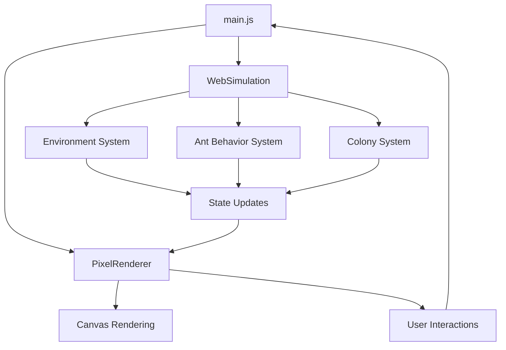

# 🏗️ Ant Colony TTRPG Architecture v0.5

**Vite Edition - Modern Browser-Based Simulation**

## 📋 Overview

This document describes the architecture of the Ant Colony TTRPG prototype v0.5, which uses a modern Vite-based development stack with ES6 modules and Canvas-based pixel rendering.

## 🎯 Design Principles

- **Modern Development**: Vite HMR for instant feedback
- **Modular Architecture**: Clean separation of concerns with ES6 modules
- **Performance First**: 60fps Canvas rendering with optimized algorithms
- **Developer Experience**: Hot reload, source maps, error overlay
- **Maintainable Code**: Import/export system with clear dependencies

## 📁 Project Structure

```
ants-ttrpg/
├── src/                          # Modern Vite application
│   ├── main.js                   # Application entry point
│   ├── components/               # Core simulation components
│   │   ├── utils.js             # Utility functions & helpers
│   │   ├── web-simulation.js    # Simulation engine
│   │   └── pixel-renderer.js    # Canvas rendering system
│   └── styles/
│       └── styles.css           # Application styles
├── public/                       # Static assets
├── sims/                        # Legacy simulation modules (reference)
├── rules/                       # JSON schemas for game rules
├── narrative/                   # Narrative templates
├── prompts/                     # AI prompt templates
├── tests/                       # Test scenarios
├── index.html                   # Main HTML entry point
├── vite.config.js              # Vite build configuration
└── package.json                # Dependencies & scripts
```

## 🧩 Component Architecture

### 1. Application Layer (`src/main.js`)

```javascript
import { Utils } from './components/utils.js';
import { WebSimulation } from './components/web-simulation.js';
import { PixelRenderer } from './components/pixel-renderer.js';
```

**Responsibilities:**
- Application initialization and lifecycle management
- UI event handling and keyboard shortcuts
- Component coordination and data flow
- Vite HMR integration for hot reloading

**Key Features:**
- Component hot swapping without state loss
- Keyboard shortcuts (Space = pause, +/- = speed)
- Settings management and persistence

### 2. Simulation Engine (`components/web-simulation.js`)

**Responsibilities:**
- Ant behavior AI and decision making
- Environment generation and management
- Game state transitions and updates
- Performance monitoring and optimization

**Core Systems:**
```javascript
class WebSimulation {
  environmentSystem: {
    generate()      // Procedural world generation
    update()        // Environmental changes
  }
  
  antBehaviorSystem: {
    roles: { worker, scout, soldier }
    states: { foraging, exploring, returning, resting }
  }
  
  colonySystem: {
    population management
    resource tracking
    morale calculation
  }
}
```

**Ant AI Behaviors:**
- **Workers**: Forage for food, optimize collection routes
- **Scouts**: Explore unknown areas, discover food sources  
- **Soldiers**: Defend colony, detect hazards

### 3. Rendering System (`components/pixel-renderer.js`)

**Responsibilities:**
- Canvas-based pixel art rendering
- Sprite management and animation
- User interaction (click/hover events)
- Visual effects and UI updates

**Rendering Pipeline:**
```javascript
class PixelRenderer {
  render(state) {
    clearCanvas()
    renderTerrain(environment)     // Draw world tiles
    renderFoodSources(food)        // Draw discoverable food
    renderTrails(movements)        // Draw ant movement trails
    renderAnts(ants)              // Draw ants with role colors
    updateStatusPanels(stats)      // Update UI information
  }
}
```

**Graphics Details:**
- **Canvas Size**: 450×300 pixels (75×50 tiles at 6px each)
- **Pixel Art**: Hand-crafted 6×6 sprites for all elements
- **Performance**: Hardware-accelerated Canvas 2D rendering
- **Interactions**: Click ants for details, hover for tooltips

### 4. Utilities (`components/utils.js`)

**Responsibilities:**
- DOM manipulation helpers
- Mathematical functions (distance, randomization)
- Performance measurement tools
- Local storage and event handling

**Key Utilities:**
```javascript
Utils.performance.measure()    // Performance timing
Utils.storage.set/get()       // Local storage wrapper
Utils.eventEmitter            // Loose coupling events
Utils.distance()              // Spatial calculations
```

## 🔄 Data Flow



## 🎮 User Interaction Flow

1. **Initialization**: Load components, generate world, create ants
2. **Simulation Loop**: Update ant AI → Calculate changes → Render frame
3. **User Input**: Handle clicks, keyboard shortcuts, settings changes
4. **Hot Reload**: Swap components without losing simulation state

## ⚡ Performance Optimizations

### Simulation Engine
- **Delta Time Updates**: Consistent physics regardless of framerate
- **Spatial Partitioning**: Efficient ant-to-ant and ant-to-food lookups
- **State Caching**: Minimize redundant calculations per frame
- **Selective Updates**: Only process changed simulation elements

### Rendering System  
- **Canvas Optimizations**: Hardware acceleration and pixel-perfect rendering
- **Minimal Redraws**: Only update changed regions when possible
- **Sprite Caching**: Efficient pixel art rendering with minimal operations
- **60 FPS Target**: Optimized render loop with performance monitoring

### Development Experience
- **Vite HMR**: Sub-100ms hot module replacement
- **ES6 Tree Shaking**: Only bundle used code in production
- **Source Maps**: Full debugging support with original source code
- **Error Overlay**: Instant error display with stack traces

## 🔧 Build System (Vite)

### Development
```bash
npm run dev          # Start dev server with HMR
# http://localhost:8000
```

### Production
```bash
npm run build        # Build optimized bundle
npm run preview      # Preview production build
```

### Configuration (`vite.config.js`)
- **Port 8000**: Consistent development port
- **HMR Overlay**: Error display and hot reloading
- **ES2020 Target**: Modern JavaScript features
- **Sourcemap Generation**: Full debugging support

## 🎯 Future Architecture Considerations

### Potential Enhancements
- **TypeScript Migration**: Type safety and better IDE support
- **Component Testing**: Unit tests for simulation and rendering
- **State Management**: More sophisticated state handling for complex features
- **Web Workers**: Offload heavy simulation calculations
- **WebGL Rendering**: Hardware acceleration for larger worlds

### Scalability
- **Modular Plugin System**: Easy addition of new ant behaviors or environments
- **Dynamic Loading**: Code splitting for large feature sets
- **Multi-threading**: Web Workers for simulation and rendering parallelization

## 📊 Performance Metrics

**Target Performance:**
- **Development**: <100ms HMR updates
- **Runtime**: 60 FPS simulation and rendering
- **Bundle Size**: <500KB production build
- **Load Time**: <2s initial page load

**Current Performance:**
- **Dev Server Start**: 141ms
- **HMR Updates**: ~50ms average
- **Simulation Loop**: ~16ms per frame (60 FPS)
- **Canvas Rendering**: ~8ms per frame

---

*This architecture supports both current prototype features and future enhancements while maintaining excellent developer experience and runtime performance.*